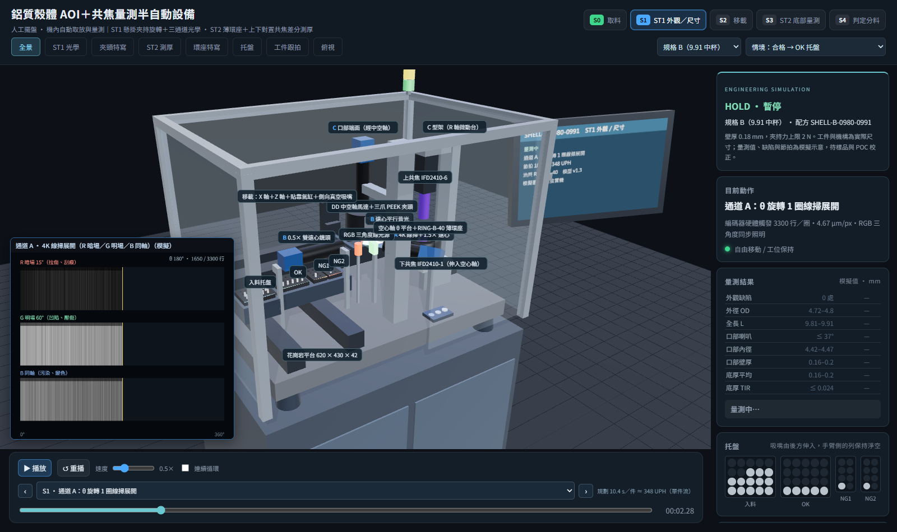

# 杯體加工件 AOI＋共焦量測半自動設備：3D 設備模擬

依 `docs/20260825_…AOI 光學檢測.docx`（Rev. A）與三張殼體圖面，把規格書的半自動機做成可播放、可逐步檢視的 3D 模擬。三種杯體加工件（Ø4.8～Ø4.9，長 4.2／9.91／13.8 mm）在同一台機上完成外觀、外形尺寸與底部厚度量測。

- **半自動**：人工擺托盤，機內移載模組自動取放與量測。
- **ST1** 由 DD 中空軸馬達＋三爪 PEEK 夾頭懸掛夾持，三個光學通道共用一次裝夾。
- **ST2** 工件落在鎢鋼薄環座上，上下對置的兩支共焦感測器做螺旋掃描，差分求底厚。
- 規劃節拍約 **11.4～11.6 秒／件（約 310～316 UPH）**；ERR 情境重測一次約 16.6～16.7 秒。所有 Three.js 依賴在 `core/vendor`，可離線執行。



文件（本機 `docs/`）：[電路圖](docs/circuit-diagrams.pdf)、[工程配置](docs/electrical-plan.md)、[整線設計與選型限制](docs/wiring-plan.md)、[報價核對](docs/quotation-summary.md)；[成本估算](docs/cost-estimate.md)（[試算表](docs/cost-estimate.xlsx)）是轉進平台前的原檔，成本以 3D工作室平台為準（見下方「成本表」）。規格書與圖面也在 `docs/`。

## 決策紀錄（選項對話）

| 題目 | 決定 |
|---|---|
| 整機架構 | 照規格書半自動（不改 SCARA 全自動或分度盤） |
| 工件範圍 | 三種杯體加工件 A／B／C；`docs/` 內的沖壓板件與帶齒管件不納入 |
| 判定情境 | OK、NG-D、NG-A、NG-T、ERR 五種 |
| 配套 | 取像模擬相機視窗、驗證腳本、成本估算表 |
| 運動元件 | 移載、Z 滑台、貼靠氣缸、R 軸微動台、DD 馬達、θ 平台、共焦感測頭不換用 core 模型：幾何是 `spec.js` 的純資料，畫面與干涉檢查同源 |

## 流程

| 站別 | 動作 |
|---|---|
| S0 取料 | 入料托盤對列 → Z 下降 → 側向真空吸嘴貼靠外壁 → 建立真空 → 上升 → 沿低位走廊到 ST1 → 杯口送入夾頭 |
| S1 ST1 | 三爪夾持 1.5 N → 破真空、吸嘴退開並下降 → **A** θ 轉 1 圈線掃展開 → **B** 0／90／180／270° 遠心剪影 → **C** 口部端面 → θ 回原點 → 吸嘴吸附 → 夾頭鬆開 |
| S2 移載 | 下降到走廊 → 到升降點 → 上升 → 進 ST2 → 落座薄環座 → 破真空、吸嘴退開 |
| S3 ST2 | 上共焦頭下降 → 穩定 0.3 s → 螺旋掃描 5 圈（120 rpm，同步方式待 POC）→ R 軸回起點 → 上頭抬升 30 mm |
| S4 判定分料 | 判定＋資料寫入（出料托盤同時對列）→ 吸附 → 回走廊 → 到目標托盤 → 放料 → 回待命位 |

交接一律先取得新的約束再解除舊的：先夾緊才破真空，先吸住才鬆夾。

### 情境

| 情境 | 內容 | 去向 |
|---|---|---|
| OK | 全部項目在規格內 | OK 托盤 |
| NG-D | 外徑超出上限（通道 B） | NG1 |
| NG-A | 外壁拉傷 0.86 mm（通道 A 紅光暗場） | NG2 |
| NG-T | 底厚低於下限（ST2） | NG1 |
| ERR | 上感測器訊號不足、有效點 62 % → 重新落座重測一次 → 仍異常 | 退回入料原穴，黃燈通知人工 |

NG 件仍走完全部量測，資料才完整。ERR 不當成 NG。

## 啟動

```powershell
node ../../core/tools/serve.mjs WorkpieceMeasurement
# 或不自動開外部瀏覽器
node ../../core/tools/serve.mjs WorkpieceMeasurement --no-open
```

開啟 [本地模擬](http://127.0.0.1:8770/WorkpieceMeasurement/)，也可在根目錄執行 `scripts\start.cmd -Station WorkpieceMeasurement`（`scripts\start.cmd -Site` 只開展示網站，`-All` 連 vs3d 介面一起開；所有專案共用 `core/tools/serve.mjs`，首頁 http://127.0.0.1:8770/ 列出全部專案）。ES module 需要 HTTP，不能直接用 `file://` 開 HTML。

## 操作

- 右上兩個選單切換**規格**（A／B／C）與**情境**，切換後重新載入。
- 站別按鈕跳到 S0～S4 最有代表性的一刻並切到對應視角；下拉選單可選任一步驟（前面標開始時間），搭配前後步與時間滑桿。
- 預設以 0.5× 播放；可調 0.25～2×，可勾「連續循環」。
- 視角：全景、ST1 光學、夾頭特寫、ST2 測厚、環座特寫、托盤、工件跟拍、俯視，以及電盤剖視、電盤透視、整線配置、拖鏈特寫、光纖整線；滑鼠可自由旋轉縮放。「全景」依機台外廓（含腳座）與視窗比例自動取景，縮放視窗時重新適配。畫面上方的工具列可收合右側資訊（◨）、開關相機視窗（▣）、追隨工件（◎）。
- **相機視窗**（左上，可拖曳、放大、開成獨立視窗）是取像模擬：通道 A 三張展開圖逐行長出來、通道 B 剪影與量測值、通道 C 端面與擬合圓、ST2 螺旋厚度圖、判定結果；頻閃取像時邊框亮起。這是繪製的示意影像，不是實拍。手機版預設收合（`?pip=1` 仍顯示）。
- 右側顯示量測結果（取像完成才出現數值）、托盤佔用、設備訊號、站別項目。
- 「匯出紀錄」產生 JSON：情境、量測值、缺陷、取像事件、版本欄位。**沒有實拍影像、沒有實測值、未接 MES。**

網址參數：
- `?spec=C&result=ERR`：規格與情境。
- `?pause&st=3&view=st2`：停在 ST2 掃描；`?pause&step=7&view=chuck`：停在夾持；`?pause&time=6.2`：指定秒數。
- `?hood=0`、`?pip=0`、`?labels`、`?grid`（顯示地面格線）、`?speed=1`、`?cam=x,y,z,tx,ty,tz`。
- `?pause&movie&pip=0`：展示影片模式。不跑網頁迴圈、不隨視窗縮放重新取景，改由 `core/movie/movie.js` 的 `installMovie` 以絕對時間逐格渲染（取樣走 `project.apply`，另加 ST1／ST2 重播與穿線護口三個影片鏡位）；畫面下方有預覽滑桿、輸出與鏡頭檢查按鈕。全自動輸出 MP4 用 `node core/tools/export.mjs WorkpieceMeasurement --mp4`（輸出在本機 `TEMP/`，不進版控、不發布）。

主控台：`window.sim.seekTo(sec)`、`pause()`、`play()`、`setView(name)`、`views`、`total`、`steps`、`events`、`stationStart`、`measurement`、`project`、`player`、`camera`、`controls`。

## 機構配置

座標 X 向右（托盤 → ST1 → ST2）、Y 向上、Z 向操作者。工件採圖面尺寸；設備與元件外廓採工程規劃包絡，非原廠加工圖。

- **移載在後側**：X 軸＋Z 軸電動滑台＋貼靠氣缸（6 mm）＋薄片側向真空吸嘴，三層群組依序串接（X 滑座 → Z 滑台 → 貼靠氣缸）。吸嘴由後方伸入，貼靠中心距工件底面 1.8 mm，落在托盤穴口與夾持帶之間。
- **低位走廊**：吸附中的工件底面高於托盤穴底 16 mm，沿 z = 0 從通道 B 鏡頭與背光下方通過。
- **ST1 光學都由前側立柱懸臂**：通道 B 鏡頭在左、平行背光在右；通道 A 在前右 60°；紅光暗場與綠光明場在前方；**通道 C 在 DD 馬達上方，經中空軸向下看杯口**。
- **ST2**：橋板架高空心軸 θ 平台，下感測器由下方伸入通孔；**R 軸微動台承載整個 C 型架**，上下感測器一起做徑向進給。
- **托盤**：入料與出料各一支梭台。吸嘴從後方伸入，所以手臂側的列必須是空的：入料從最後一列取起，出料從最前一列放起。

## 與規格書不同的地方

| 項目 | 規格書 | 模擬 | 原因 |
|---|---|---|---|
| 移載 X 行程 | Y 軸 250 mm | X 軸約 520 mm | 250 mm 到不了四個托盤的 20 穴與兩個工位 |
| 移載 Z | 氣缸 | 電動滑台 | 三種規格的夾持、落座高度都不同 |
| 吸嘴貼靠 | 未提 | 加 6 mm 貼靠氣缸 | 側向吸外壁需要水平接近 |
| 托盤 | 固定 | 梭台對列 | 移載只有 X／Z，列方向要由托盤移動 |
| 通道 C | 圖 4-2 畫在工件下方 | DD 馬達上方經中空軸 | 杯口朝上，由下方看不到端面 |
| R 軸 | 只載上感測器 | 載整個 C 型架 | 差分測厚要量同一點的上下兩面，只動上感測器會錯位 |
| 三支柱 | 高 70 mm | 高 20 mm＋轉接板 | 支柱要在下感測器鏡頭（Ø27）外側，薄環座（Ø30）放不下 |
| 節拍 | 9.4 s | 11.4～11.6 s | 進 ST2 前要先繞過背光與平台，多一個升降點 |
| 移載位置 | 圖 4-1 在上方 | 後側低位 | ST1 上方是夾頭與通道 C |

## 圖面判讀與規格書不一致，待確認

| 規格 | 規格書 | 依圖面判讀（模擬採用） | 影響 |
|---|---|---|---|
| A | 底部 Ø2.60 為「中心特徵」，環座內孔 Ø2.0 | Ø2.60 是貫穿孔 | 孔內沒有材料可量；改成環座內孔 Ø4.0，量測區是 r 1.45～1.85 mm 的環帶 |
| A | 底厚 0.30 | 0.297 −0.076（0.221～0.297） | 判定門檻 |
| C | 內徑 Ø4.3、壁厚 0.3、階梯內孔 | 口部是**外徑** Ø4.3 的縮頸（長 1.8、45°），內孔 Ø3.72 直通，壁厚約 0.57 | 夾頭夾縮頸；口部壁厚門檻改為 0.19～0.29 |
| C | 底孔是否貫穿未定（R-02） | 視為貫穿 | 量測區是 r 1.30～1.62 mm 的環帶 |

這四項是讀圖的結果，沒有實物佐證。

## 外觀與舞台

- 舞台：`createStage({ look: 'studio' })` 提供曝光、背景與主光／補光／輪廓光的顏色與強度；`main.js` 只寫霧、相機與控制範圍（不限仰角）、主光位置與陰影（`mapSize` 依視窗寬度 4096／2048）、補光位置。燈位與陰影範圍是原本手調值，不用 `extent` 推算。
- 地面：`project.js` 用 `@core/geom/environment.js` 的 `floor()`，但傳入本站的展示地面：100 m 見方、0x29323a 粉體塗裝紋理，邊緣隱入霧中；格線 6 m、100 mm 一格，預設隱藏（`?grid` 顯示）。
- 材質：花崗岩顆粒、金屬拉絲、霧面烤漆與機櫃門板紋理集中在 `web/js/render-finishes.js`（固定種子、啟用 mipmap，不會逐格變動）。機台本體材質的顏色與金屬度和 `MAT`／`finished()` 不同，留在本站；電盤細節的鋼件、深色線槽、橡膠件與吸嘴墊片用共用 `MAT`。原始文件以工程圖與概念示意為主，外觀不是依實機照片校色，門板銘牌與通風紋理是美術示意。
- 市購品用 core 模型的只有三色燈 `signalTower` 與 `hmi`（`@core/models/indicators.js`）；電控元件外形用 `core/electrical/electrical-components.js` 的配置示意。
- 小螢幕：≤900 px、觸控平板與手機橫向由 core 精簡版面接手（☰ 製程與視角、⚙ 播放設定、◨ 側欄抽屜可捲到底）；精簡版面的細節說明放在畫布左上、工具列下方。`style.css` 只留 900～1100 px 的桌面規則，以及非觸控矮視窗（`body:not(.viewer-compact)`、`max-height:520px`）的規則。全景已依畫面比例取景（`render-finishes.js` 的 `overviewFrame`），視角帶 `{ fit: false }` 不再讓 stage 的窄畫面拉遠，手機直向不會拉遠兩次。
- 3D 標籤（`?labels` 或勾「顯示設備標籤」）：通道 A 線掃、DD 夾頭、移載、上共焦、θ 平台環座、入料托盤設 `priority: 2`，小螢幕避讓時優先保留。

## 電控與配線

- 共焦套組：CL-3000、CL-S015 ×2、CL-S015N ×2、CL-CV5 ×2、OP-88864 ×1 照同一報價套組整併。OP-88864 是感測頭對置調整治具；ST1 夾頭與 ST2 環座另外設計。上頭有避讓軸、固定支架、實際穿線孔與護口。
- 「電盤剖視」「電盤透視」「整線配置」看電盤與整機配線。材料與器件尺寸、線徑、彎曲半徑、熱負載和原廠接腳要待選型確認，電路圖是工程規劃用途。
- 「拖鏈特寫」「光纖整線」看活動線束：X／Z 分開採固定長度折返拖鏈，氣管與共焦光纖另設補償環；相機線沿支柱與承架收納並有端部固定。移動線材支架掛在所屬軸（X、Z、C 型架、上感測頭）上；X 拖鏈固定座走 Z 行程下方（y ≤ 1002）再由後側立柱接到鏈端。原廠光纖彎曲半徑和拖鏈壽命尚待核定。
- `web/js/wiring-plan.js` 是路徑與支架資料，`wiring-render.js` 依同一份資料繪製，`tools/verify-wiring.mjs` 也讀它。
- 重建電路圖：先 `node project-site/WorkpieceMeasurement/tools/export_control_plan.mjs`（輸出到本機 `docs/electrical/`），再 `python tools/circuit-drawings/render.py WorkpieceMeasurement`（需 reportlab 與中文字型；本站的圖紙定義在 `tools/circuit_sheets.py`）。

## 檔案

| 檔案 | 用途 |
|---|---|
| `web/js/spec.js` | 規格、判定門檻、機構尺寸（`fixedBodies`／`transferBodies`，畫面與干涉檢查共用）、托盤規則、模擬量測值 |
| `web/js/sequence.js` | 逐步流程，建在 `core/anim/sequence.js` 的 `createStepSequence` 上：`step(動作, 說明, { to, set, dur, ease })` 只負責由軸限速反推時間，每步的緩動（三次 smoothstep／trap）以 `ease` 交給 core 插值；提供 `events`、`stationStart`、`total` |
| `web/js/collision.js` | 間隙計算 |
| `web/js/product.js` | 工件（依剖面車出） |
| `web/js/machine.js` | 機台、托盤、移載、光束示意；三色燈與 HMI 用 core 模型 |
| `web/js/equipment-detail.js` | 電盤與周邊設備細節（電控元件、整線） |
| `web/js/control-plan.js` | 3D 電盤、圖面與成本核對共用的元件、軸與 I/O 清單 |
| `web/js/wiring-plan.js`、`wiring-render.js` | 線材路徑與支架資料、依資料繪製線材 |
| `web/js/render-finishes.js` | 展示用材質與紋理、全景取景 |
| `web/js/camera-sim.js` | 取像模擬（612 × 512 座標的 2D 示意圖，經 `createViewerWorkspace` 的 `renderImage` 畫進共用相機視窗） |
| `web/js/project.js` | 專案介面：建地面（共用 `floor()`，本站展示地面材質）與機台，`apply(t)` 把整個場景放到時間 t（`main.js` 與統一檢查共用），`verify` 的允許規則也在這裡 |
| `web/js/main.js` | 舞台設定、播放列（`core/ui/player.js` 的 `createPlayer`：`speed: .5`、`#loop` 連續循環）、站別按鈕與網址參數、視角（`stage.goTo`；工件跟拍每格以 `stage.shiftView` 平移）、3D 標籤（`stage.addLabel`／`updateLabels`）、介面、紀錄匯出、`?movie` 錄影掛勾 |
| `web/css/style.css` | 桌面版面、側欄卡片、量測表與托盤圖；精簡版面由 `core/ui/viewer-workspace.css` 處理 |
| `tools/verify.mjs` | 流程／幾何／運動驗證 |
| `tools/verify-details.mjs` | 電盤、穿線孔、線材與光纖細節檢查 |
| `tools/verify-wiring.mjs` | 15 組流程的線長、活動線束與支架干涉 |
| `tools/export_control_plan.mjs`、`circuit_sheets.py` | 匯出電路圖資料、本站圖紙定義 |

## 成本表

成本表在 3D工作室平台上維護：本站頁面的「成本表」分頁可以看、改、存快照、匯出 xlsx（命令列 `node studio/vs3d.mjs parts bom @WorkpieceMeasurement`）。本機 `docs/cost-estimate.xlsx` 是轉進平台前的原檔。core 的 `bom` 檢查把場景用到的 core 模型對照平台的 BOM，落差（只警告）在 `review/bom-checks.json`。

## 驗證

需要 Node.js 22 以上，不需 npm 套件。統一檢查：

```powershell
node ../../core/tools/check.mjs WorkpieceMeasurement           # 在本資料夾；在庫根目錄則為 node core/tools/check.mjs Workpiece
node ../../core/tools/check.mjs WorkpieceMeasurement --quick   # 快速檢查（部署前跑的那一組）
```

- core 內建：`imports`、`structure`、`names`、`determinism`（倒序／跳播一致）、`layout`、`scene`（全場動態干涉、架設相撞、重合面閃爍，結果在 `review/scene-verification.json`；地面與光束示意不列入）、`electrical`（電控元件，結果在 `review/electrical-checks.json`）、`physics`（本站沒有用，略過）、`bom`（只警告）；完整檢查另跑 `ui`（四種尺寸的標準互動測試，結果在 `review/ui-check.json`，平行執行時用 `UI_PORT` 指定 port）。`scene` 與網頁用同一個 `web/js/project.js` 建場景，檢查的就是畫面上的幾何。
- `project.json` 的 `variants` 另外檢查規格 A／NG-A 與 C／ERR 兩組（工件、環座、夾爪與流程不同）；三組的 `scene` 都是 0 筆干涉、0 筆重合面。站的允許規則只有兩條：移動線材端點接入自己的接頭座、固定線材在 x ±290 匯入穿過桌板的線束與線夾。
- 專案自有：快速檢查跑 `tools/verify.mjs`；完整檢查再跑 `tools/verify-details.mjs`、`tools/verify-wiring.mjs`。這些腳本引用 `@core/`，單獨執行時經共用 loader：

```powershell
node ../../core/tools/run.mjs WorkpieceMeasurement tools/verify.mjs           # 結果在 review/verification.json
node ../../core/tools/run.mjs WorkpieceMeasurement tools/verify-details.mjs   # 結果在 review/detail-verification.json
node ../../core/tools/run.mjs WorkpieceMeasurement tools/verify-wiring.mjs    # 結果在 review/wiring-verification.json
```

`tools/verify.mjs`：三種規格 × 五種情境共 15 個組合，每 20 ms 取樣：

- 結束狀態與分流正確，必要步驟全部完成，吸嘴與夾頭回到安全狀態。
- 任意跳站與倒退，同一時刻的狀態相同。
- 工件位置在所有交接點連續（不跳位）。
- X 軸 ≤ 1200 mm/s、Z 軸 ≤ 400 mm/s。
- 吸附中真空必須存在；工件掛在夾頭時夾頭必須夾緊；ST2 掃描時移載不動；θ 旋轉時吸嘴已下降避讓。
- 移載（吸嘴、手臂、Z 滑台、吸附中的工件）對固定機構、夾爪、托盤與盤內工件的最小間隙 ≥ 0.2 mm。
- 上頭量測到位與移載避讓互鎖；光路可及性另列待實測，不用假設 NA 通過檢查。

最近一次結果全部通過。最小間隙：對托盤 0.30 mm（吸嘴底面到托盤上表面）、對夾爪 0.55 mm（規格 A）、對固定機構 0.68 mm（規格 A 落座前）。CL-S015 沒有完整光錐資料，因此不宣稱杯口光路通過（`cone` 欄位標「待原廠光路圖與實物可及性驗證」）。`verify.mjs` 不檢查底櫃、外罩、HMI 與光束示意，這些由統一檢查涵蓋。

`tools/verify-details.mjs`：盤內元件包絡、穿線孔射線、線材有限座標／櫃內轉彎、升降導軌及共焦光纖對 C 型架間隙，627 個狀態通過；其餘線材與全機物件配對、彎曲半徑與原廠端子不在檢查範圍。`tools/verify-wiring.mjs`：15 組流程共 6,219 個狀態的線長、主要機構、活動線束相互距離（不同軸的移動支架不得互相穿過）與支架干涉，最小間隙 0.20 mm。

以上都是離散取樣的模型檢查，不是實機安全或公差認證。

## 限制

- 量測值、缺陷、有效點數都是寫在 `spec.js` 的示意值，用來展示判定與分流，不是演算法輸出。
- 外觀允收基準、底部平整度規格、夾持力與夾持變形都還沒有實測依據（規格書 R-04、R-05）。
- CL-S015 參考距離依原廠為 15 mm，一般量程 ±1 mm；外形是安裝包絡，非原廠 CAD。狹口量內底須先做樣品 POC。
- 吸嘴貼靠帶很窄：規格 A 全長 4.2 mm，扣掉托盤穴深 1 mm 與夾持帶 1.5 mm，只剩 1.7 mm。薄片吸嘴的剛性與吸附力要做實物確認。
- 使用者確認工件為「杯體加工件」，用途為機構零件；舊 AI 規劃書的工件命名不採用。
