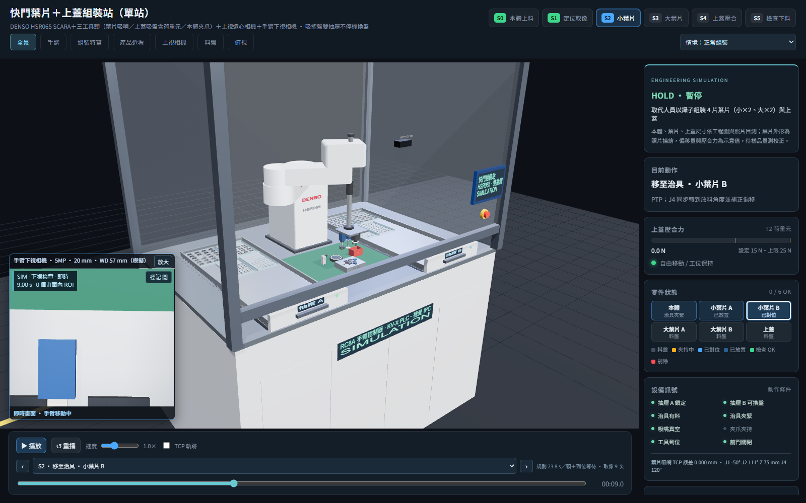
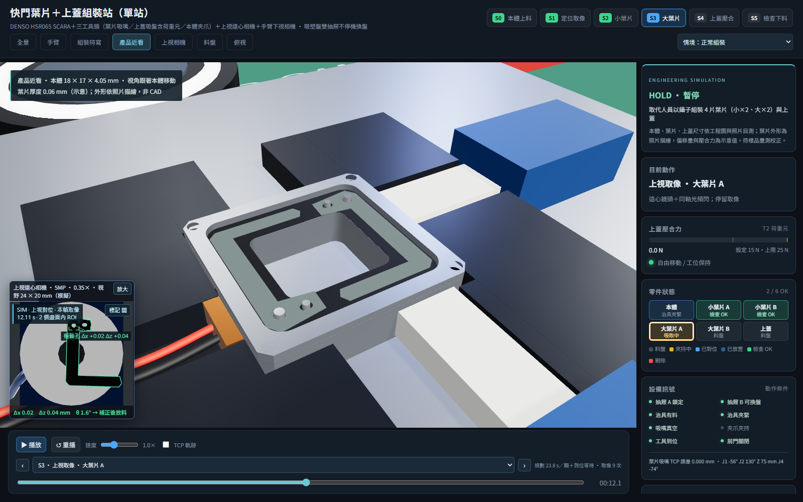
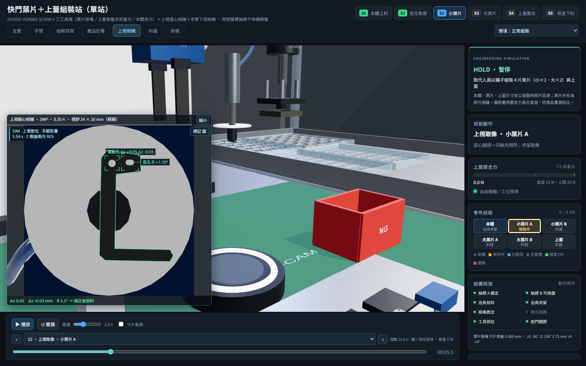
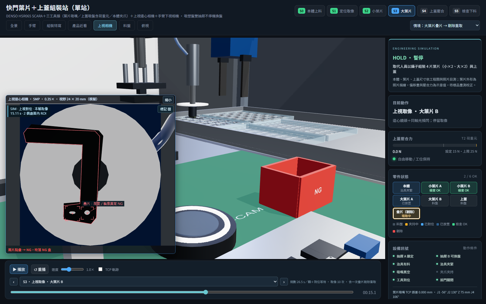
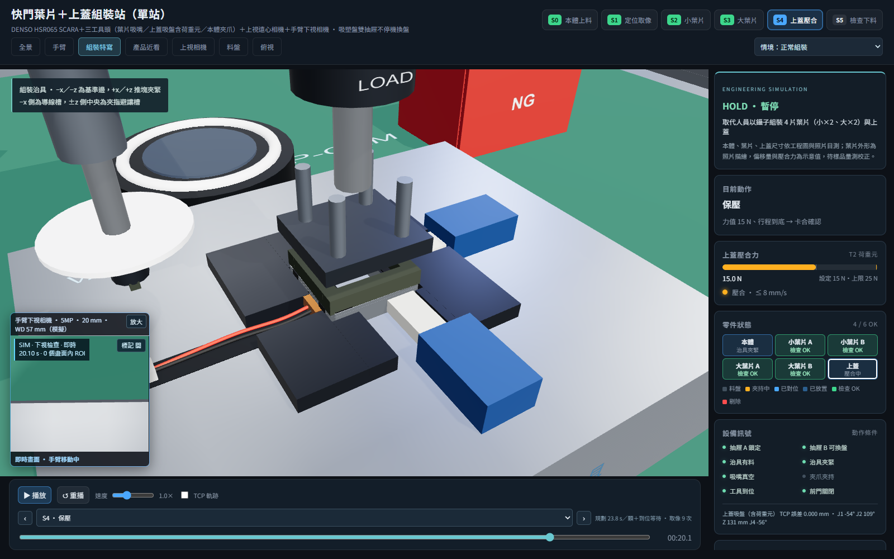
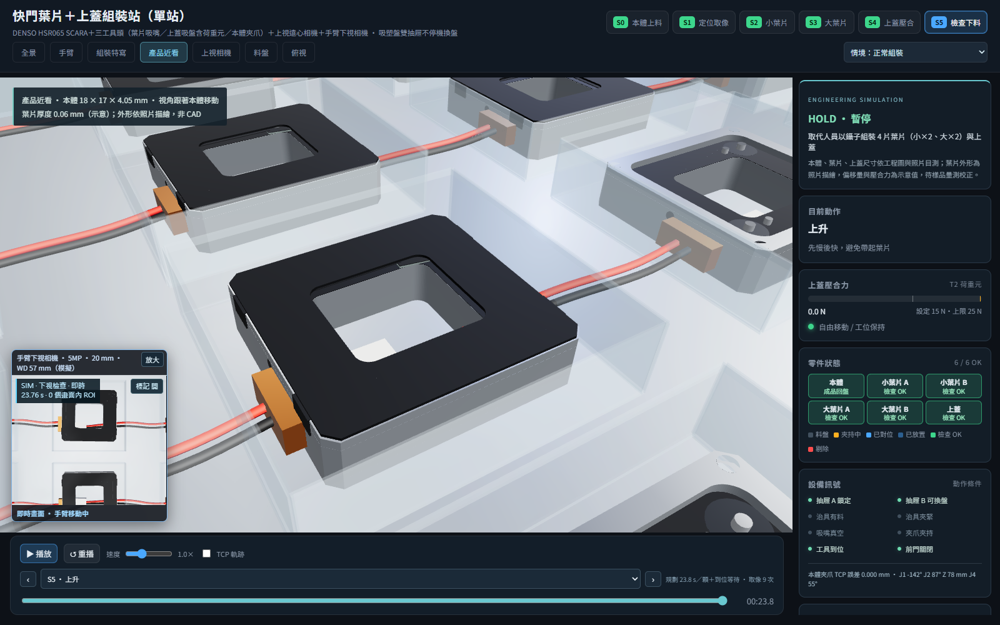
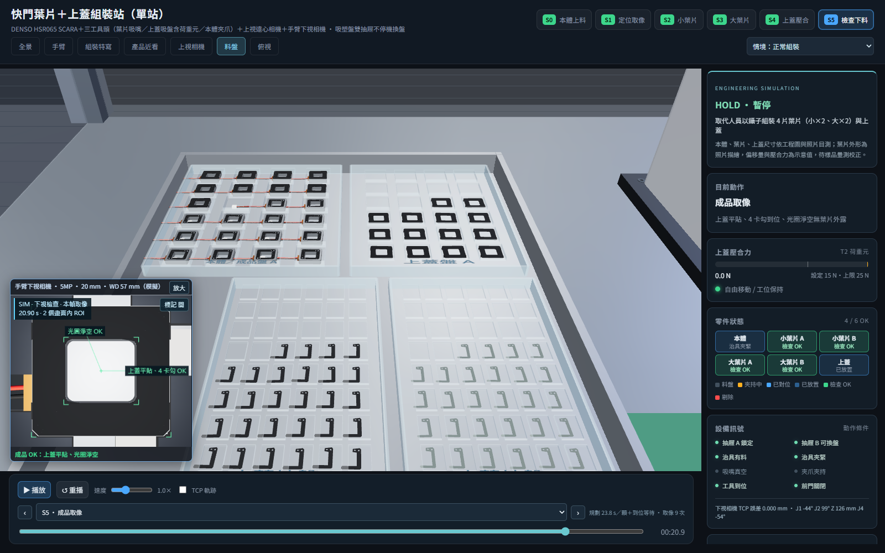

# 快門葉片＋上蓋組裝站：自動化方案 3D 模擬

取代影片中人員用鑷子組裝快門的作業：把 4 片葉片（小×2、大×2）套到本體的樞軸銷與撥桿銷上，再蓋上上蓋壓合。單站、一台 SCARA 完成全部動作。

- **DENSO HSR065 SCARA**＋三工具頭：T1 葉片吸嘴（多孔吸盤＋白色背景板）、T2 上蓋四點真空墊＋均壓外框（含荷重元，兼壓合）、T3 本體夾爪。三支工具各有氣動滑台，只有使用中的伸出。
- **上視遠心相機**量葉片與上蓋在吸嘴上的偏移，J4 轉到放料角度並補正後才放料；**手臂下視相機**定位銷、檢查疊放與成品。
- **雙抽屜吸塑盤**：每個抽屜一套 24 顆的料（本體／成品、上蓋、小葉片、大葉片），一個供料時另一個可以拉出換盤；成品放回本體盤原格。
- 規劃循環約 **23.8 秒／顆**（人員約 30 秒／顆）。所有 Three.js 依賴在 `core/vendor`，可離線執行。

文件（本機 `docs/`）：
- [自動化方案規劃](docs/automation-plan.md)：現況分析、設備配置、末端工具、治具、節拍、精度預算、選型、風險與待確認。
- 成本表在 3D工作室平台維護（見下方「成本表」）；[成本估算](docs/cost-estimate.md)（[試算表](docs/cost-estimate.xlsx)）是轉進平台前的原檔，以平台為準。
- 使用者提供的工程圖、照片與影片在 `docs/`。



## 決策紀錄（選項對話）

| 題目 | 決定 |
|---|---|
| 運動平台 | DENSO SCARA（不用伺服 XYZθ 模組或六軸手臂） |
| 葉片供料 | 改用吸塑盤排列（柔性振動供料盤列為備案） |
| 葉片組成 | 小葉片 ×2＋大葉片 ×2，兩個樞軸各疊一小一大 |
| 進出料 | 吸塑盤進出、雙抽屜不停機換盤 |

## 流程

| 站別 | 動作 |
|---|---|
| S0 本體上料 | T3 從本體盤 #10 夾本體 → 放入治具 → 推塊推靠基準邊夾緊 |
| S1 定位取像 | 下視相機找 2 支 φ0.80 樞軸銷與 2 支撥桿銷 |
| S2 小葉片 | 每片：T1 吸取 → 上視相機量偏移 → J4 轉向並補正 → 慢速套入銷 → 放開；2 片後下視檢查 |
| S3 大葉片 | 同上；4 片後檢查疊放順序 |
| S4 上蓋壓合 | T2 吸上蓋 → 上視對位 → 放上 → 壓合 15 N、保壓 0.3 s → 破真空 |
| S5 檢查下料 | 下視拍成品 → 鬆開夾緊 → T3 夾成品放回本體盤原格 |

「情境」選單可切換**大葉片疊片 → 剔除重取**：上視相機發現兩片黏疊，吸嘴移到 NG 盒吹落，改取下一格。

## 啟動

```powershell
node ../../core/tools/serve.mjs "shutter assembly"
# 或不自動開外部瀏覽器
node ../../core/tools/serve.mjs "shutter assembly" --no-open
```

開啟 [本地模擬](http://127.0.0.1:8770/shutter%20assembly/)，也可在根目錄執行 `scripts\start.cmd -Station "shutter assembly"`（`scripts\start.cmd -Site` 只開展示網站，`-All` 連 vs3d 介面一起開；所有專案共用 `core/tools/serve.mjs`，首頁 http://127.0.0.1:8770/ 列出全部專案）。ES module 需要 HTTP，不能直接用 `file://` 開 HTML。

線上版：推送到 `main` 時由根目錄 `.github/workflows/pages.yml` 跑快速檢查，通過後自動建置並發布全部站（[發布說明](../../tools/github-pages/README.md)）。

## 操作

- 站別按鈕跳到 S0～S5（直接停在該站第一次取像）；下拉選單可選任一步驟（前面是步驟起始時間），搭配前後步與時間滑桿；速度滑桿 0.05～3×。
- 視角：全景、線材配置、電盤配線、手臂、組裝特寫、產品近看（跟著本體移動）、上視相機、料盤、俯視；滑鼠可自由旋轉縮放。
- **左下子畫面**是相機實際看到的畫面：零件停在上視相機上方時顯示上視遠心相機（黑色葉片對白色背景板的剪影），其他時間顯示手臂下視相機。標記框與偏移量是模擬值，可用「標記 開／關」切換；「放大」保持完整感光元件比例。
- 右側「零件狀態」顯示本體、4 片葉片與上蓋目前在料盤、夾持中、已對位、已放置或檢查 OK。
- 「匯出紀錄」產生 JSON：情境、各零件狀態與示意偏移量、取像事件。**沒有實拍影像、沒有實測力值、未接 MES。**

網址參數：
- `?result=NG`：疊片剔除情境。
- `?pause&st=2&view=upcam`：直接看小葉片上視對位（`st` 搭配 `t` 是該站起點再加秒數）；`?step=<編號>` 跳到某一步。
- `?pause&time=20.1&view=nest`：壓合瞬間；`time` 為流程秒數。
- `?cameraSize=large`、`?shadow=0`、`?cam=x,y,z,tx,ty,tz`。

主控台：`window.sim.seekTo(sec)`、`pause()`、`play()`、`setView(name)`、`views`（視角名稱）、`total`、`T`、`steps`、`events`、`stationStart`。

## 建模

座標單位 mm。產品依 docs 的工程圖、組裝示意、6 張零件照片與約 66 秒影片的抽幀建立；沒有標註的外形、線圈與表面粗糙度是依照片做的示意，不是量測 CAD。



- **產品**：本體 18 × 17 × 4.05（照片量測＋工程圖 A）、光圈 9.4 × 8.4、四角孔、側面 M1.6 螺孔、轉子座與轉子環、φ0.80 樞軸銷與撥桿銷、兩端內凹線圈腔與銅繞組、紅黑導線（本體左側預成形 U 彎）與白色端子。葉片是帶弧線的 C 形沖切輪廓，一端有圓孔與長孔（機器視覺描邊用同一條曲線）；小葉片灰色、大葉片黑色，厚 0.06。上蓋 0.20（工程圖 O），有貫穿沖孔與 4 個卡勾，本體有對應的卡勾避讓與扣合槽。
- **手臂**：HSR065（core 的 `denso-hsr065.js`）動作範圍 650、Z 行程 200。臂長 350＋300、J1 座高、關節範圍與速度（假設型錄值的 50%）待以 DENSO 型錄與 CAD 核對。解析逆解在 core，本站依流程順序選離前一點最近的肘部解，J4 取最接近的等價角。
- **工具**：T1 背景板直徑 32，完整蓋住 24 × 20 的相機視野，細真空管藏在葉片吸附區內；T2 四個真空墊避開上蓋沖孔，均壓板、吸附墊與背架一起浮動，壓合過行程由四根彈簧吸收（最大壓縮 0.30），顯示的力值依壓縮量變化。
- **運動**：自由移位走關節插值（PTP），時間依關節角度差自動算；下降、接近、上升走直線，最後 2 mm 減速到 30 mm/s，壓合 8 mm/s。
- **零件歸屬**：零件在料盤、工具上（跟著實際 TCP 移動）、治具、本體上或 NG 盒；吸取、放開的瞬間才換歸屬，所以動畫位置連續。夾爪閉合期間逐步校正示意偏移，治具鬆開後本體留在已定位的位置。放在本體上的葉片與上蓋會跟著本體一起被夾回料盤。NG 葉片從吸嘴自由落下（約 0.109 s，重力加速度 9,810 mm/s²）停在盒底。
- **上視補正**：每片料在格內有示意偏移（例如小葉片 A：Δx +0.05、Δz −0.03 mm、θ +1.1°），吸嘴對準格中心吸取，上視相機量得偏移後修正放料位置與 J4 角度。台板、ESD 墊、環形光與鏡筒都有同軸開孔，上視光路是通的。
- **外罩**：占地 1440 × 1120。

導線預成形、卡勾避讓槽與 0.20 張開行程、浮動壓頭的彈簧行程都是模型的設計假設，要依實物或供應商 CAD 確認；壓合 15 N 是示意值。干涉與物理檢查的範圍見[物理檢查紀錄](review/physical-review.md)。

## 檔案

| 檔案 | 用途 |
|---|---|
| `web/js/product.js` | 本體、葉片、上蓋、成品幾何；樞軸銷與葉片安裝位置 |
| `web/js/cell.js` | 機台、雙抽屜與 4 種吸塑盤、組裝治具、上視相機、離子風嘴、NG 盒、外罩；料格座標。市購品用 core 模型：上視相機 `visionCamera`（`@core/models/vision.js`）、離子風嘴 `ionizer`（`equipment.js`）、治具夾緊氣缸 `airCylinder`、抽屜滑軌 `drawerSlide`、門互鎖開關 `doorSwitch`（`motion.js`）、三色燈／HMI／急停（`indicators.js`）。鋁擠型框架用 `MAT.frame`，治具座與抽屜用 `finished(MAT.alu, 'metal')`，台面板用 `finished(MAT.steel, 'metal')`（較深，維持與吸塑盤的對比）。地面用 core 的 `floor()`（`@core/geom/environment.js`：9 × 6 m 深色地坪＋200 mm 格線） |
| `web/js/robot.js` | 手臂本體與解析逆解用 core 的 `createHSR065`（`@core/models/robots/denso-hsr065.js`）；本檔裝三工具頭（氣動滑台 `slideTable`、T2 荷重元 `loadCell`、T3 夾爪 `parallelGripper`，都在 `motion.js`）、下視相機（`visionCamera`）、TCP、作業姿態追蹤與手臂安裝高度 |
| `web/js/sequence.js` | 單顆組裝流程、料件偏移與補正。排程本體是 core 的 `createStepSequence`（快照、插值、`stationStart`、`total`、`events`；零件歸屬 `loc` 用 `latch` 在步驟完成才換，NG 落下步驟以 `easeKeys: { drop: linear }` 讓 `drop` 隨時間線性）；本檔只做取放料拆解、PTP 時間依關節速度延長、NG 疊片剔除，取樣時補上 SCARA 姿態（PTP 關節插值／直線段） |
| `web/js/station.js` | 組裝整站、依歸屬擺放零件（畫面與驗證共用） |
| `web/js/project.js` | 專案介面 `createProject({ scene })`：建立整站與流程，`apply(t)` 把整個場景放到時間 t；網頁與 core 統一檢查共用（`?result=NG` 對應 `ng: true`）；`verify` 的允許規則與配線情境 `verify.cables` 也在這裡 |
| `web/js/main.js` | renderer、場景、相機、軌道控制、環境光與主要燈光由共用舞台 `createStage`（`core/ui/stage.js`）建立：外觀用 `look: 'cell'`，本檔只傳差異（RoomEnvironment 點光 220、太陽與補光位置、陰影範圍與 bias、霧、縮放距離）；燈位與陰影照原本手調值明確寫，不用 `extent` 推算；作業區局部光（跟隨本體、細緻陰影）在本檔。畫面迴圈用 `stage.loop`（自訂繪製：HUD＋主畫面＋相機子畫面）；3D 標籤用 `stage.addLabel`／`updateLabels`（小螢幕重疊時依 `priority` 先留手臂，其次治具與上視相機），視角轉場用 `stage.goTo`（窄畫布由 stage 自動拉遠；橫向手機畫布寬高比 > 2 時，上視相機視角整體下移 30 mm，環形光才不會落在畫布底邊，桌面不變），追隨鏡頭接手時 `stage.cancelTween()`，產品近看跟著本體用 `stage.shiftView`（轉場中也跟）。播放列用 `createPlayer`（`core/ui/player.js`，事件選單取排程的 `events`）：跳播走 `apply(T, { seek: true })`（手臂直接到位），連續播放走 `advance(T, dt)`：以 5 ms 細分、手臂以實際限速追蹤，步驟結束（含最後一步）或接近／接觸中偏離時等到位才前進，等超過 5 秒回傳 `null` 讓播放列停住並報逾時，再按播放時手臂先重新到位。`window.sim` 由 `exposeSim` 提供。網址 `?movie` 時不跑畫面迴圈，改由 `core/movie/movie.js` 的 `installMovie` 依絕對時間逐格錄影（取樣走 `project.apply`，鏡頭跟著手上的零件） |
| `web/js/camera-view.js` | 相機子畫面的繪製 |
| `web/js/vision-results.js` | 相機標記（孔位、疊片、銷位、成品） |
| `web/css/style.css` | 版面與面板樣式。≤900 px、觸控平板與橫向手機由 core 的精簡版面（`createViewerWorkspace`）接手，本檔只留 900～1100 px 桌面窄視窗的規則；精簡版面中產品近看／組裝特寫的說明貼齊畫布頂端（`--viewer-top`），不壓在產品上 |
| `tools/verify.mjs`、`verify-physics.mjs`、`verify-product-detail.mjs` | 專案自有驗證（流程、物理可行性、產品細節） |

## 成本表

成本表在 3D工作室平台上維護：本站頁面的「成本表」分頁可以看、改、存快照、匯出 xlsx（命令列 `node studio/vs3d.mjs parts bom "@shutter assembly"`）。本機 `docs/cost-estimate.xlsx` 是轉進平台前的原檔。core 的 `bom` 檢查把場景用到的 core 模型對照平台的 BOM，落差（只警告）在 `review/bom-checks.json`。

## 驗證

需要 Node.js 22 以上，不需 npm 套件。統一檢查：

```powershell
node ../../core/tools/check.mjs shutter            # 在本資料夾；在庫根目錄則為 node core/tools/check.mjs shutter
node ../../core/tools/check.mjs shutter --quick    # 快速檢查（部署前跑的那一組）
```

- core 內建：`imports`、`structure`、`names`、`determinism`（倒序／跳播一致）、`layout`、`scene`（全場動態／靜態干涉與重合面閃爍，結果在 `review/scene-verification.json`）、`electrical`（配線與電盤，結果在 `review/electrical-checks.json`）、`physics`（本站沒有用 core 的剛體動力學，略過）、`bom`（只警告）；完整檢查另跑 `ui`（四種尺寸的標準互動測試，結果在 `review/ui-check.json`，平行執行時用 `UI_PORT` 指定 port）。
- `project.json` 的 `variants` 另外檢查疊片 NG 情境（`ng: true`）；正常與 NG 兩種情境的 `scene` 都是 0 筆干涉、0 筆重合面。產品內部的薄片配合（0.02～0.3 mm）小於 core 的設備尺度門檻（重合面 0.6 mm、穿插 2 mm），由下面的專案驗證以 0.005 mm 檢查。
- 專案自有：快速檢查跑 `tools/verify.mjs`；完整檢查再跑 `tools/verify-physics.mjs`、`tools/verify-product-detail.mjs`。單獨執行：

```powershell
node --import ../../core/tools/register.mjs tools/verify.mjs                  # 流程，結果在 review/verification.json
node --import ../../core/tools/register.mjs tools/verify-physics.mjs          # 物理可行性，結果在 review/physics.json
node --import ../../core/tools/register.mjs tools/verify-product-detail.mjs   # 產品細節，結果在 review/product-detail.json
```

`tools/verify.mjs`（正常與疊片 NG 兩種情境）：
- 全部步驟代表時刻的 TCP 可達性（PTP 步驟檢查終點）與關節限位；兩個抽屜 576 個取料位置（每格取料高度＋移動高度）全部搆得到，最小關節餘裕 7.6（° 或 mm）。
- 任意倒退／跳站後狀態與 TCP 目標一致。
- 工具頭對治具槽壁、推塊、上視環形光、離子風嘴、NG 盒、抽屜、手臂基座與外罩的碰撞（接近與接觸步驟只允許吸盤、吸嘴桿與夾指進入產品與料盤包絡）；夾持中的零件在移動段不得碰撞。
- 放料瞬間，零件實際位置對目標位姿的誤差 ≤ 0.005 mm（以未補正 0.02 mm 偏移做反向測試，確認這項檢查抓得到）；結束時 4 片葉片的圓孔與長孔都對準銷、疊放順序正確、上蓋壓到底並對正、成品回到原格。
- 9 次（NG 10 次）取像時，被拍物完整在相機視野內。
- 連續播放（實際限速＋到位等待，每 0.25 秒做一次碰撞檢查）。規劃節拍正常 23.76 s、NG 26.61 s。

`tools/verify-physics.mjs`：正常 1,315、NG 1,471 個姿態（最長 20 ms 間隔，含步驟端點），工具與固定障礙、手臂、料盤壁與底，手臂與外罩；手臂距後罩最小 78.29 mm，壓合時彈簧最大壓縮 0.30 mm；另檢查料格容納、201 個上蓋接近／卡扣位置與上視光路。`tools/verify-product-detail.mjs`：9 個上蓋貫穿孔、324 個上蓋吸附面取樣、葉片吸附面、線圈與最低葉片 0.135 mm 的淨空，以及正常／NG 流程 1,287 條上視相機光線的輪廓遮擋。

以上都是離散取樣的模型檢查，不是實機安全或公差認證。模擬中的放料誤差是補正計算的誤差，**不是設備精度**，設備精度看[規劃文件第 7 節](docs/automation-plan.md#7-精度預算)。

## 畫面

| | |
|---|---|
|  上視遠心相機量葉片偏移 |  疊片判定 NG |
|  上蓋壓合 15 N |  成品放回原格 |
|  抽屜 A 的 4 種吸塑盤 | |

## 線材配置

「線材配置」視角與配色說明顯示主要外露線束、固定夾、分隔線槽與活動拖鏈：SCARA 兩臂固定護套、R25 mm Z 軸拖鏈、旋轉入口與末端氣管；相機與治具線路沿固定支架及機櫃整理。

[配線研究與實機確認項目](../../tools/docs/cable-routing-review.md)｜[本機 docs 配線紀錄](docs/cable-management.md)｜[配線與電盤檢查結果](review/electrical-checks.json)｜[配線畫面](review/cables.png)

配線與電盤檢查由 core 的 `electrical` 執行（快速檢查就會跑；情境與障礙物宣告在 `web/js/project.js` 的 `verify.cables`）：`node ../../core/tools/check.mjs "shutter assembly" --only electrical`。

## 視窗操作與產品焦點

相機標題列可拖曳，右上角可放大、獨立開窗或隱藏；主畫面上方的 ◧／◨ 可收合資訊，▣ 恢復相機面板，◎ 切換近距離產品追隨。獨立視窗共用主時間軸與檢測標記。

[完整操作說明與驗證範圍](../../tools/docs/viewer-controls.md)｜[介面畫面](review/viewer-workspace.png)

## 電控規劃檢視

上方「⚡ 電控規劃」可查看元件用途、功能連接及配置外形；支援剖視、透視、點選與特寫，顯示狀態共用主時間軸。[本站元件清單](docs/electrical-plan.md)。

## 電路圖

[圖紙索引與設計說明](docs/circuit-diagrams.md) · [A3 PDF 圖冊](docs/circuit-diagrams.pdf)。可編輯 SVG 與圖面資料在本機 `docs/electrical/`。
