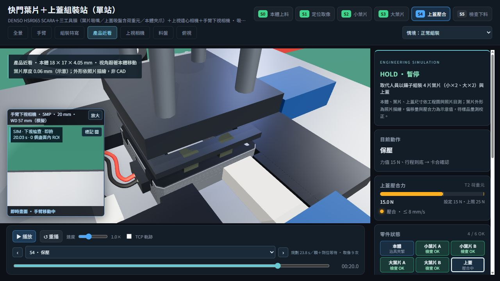

# 快門組裝動畫：干涉與物理可行性檢查

檢查對象是目前的網頁幾何與正常／疊片 NG 動作序列，長度單位 mm。數據來自 `tools/verify-physics.mjs`、`tools/verify.mjs`、`tools/verify-product-detail.mjs`（完整檢查會跑，也可以單獨執行，見站的 `README.md`「驗證」）。

## 為了通過檢查而定下的設計

| 項目 | 目前的做法 |
|---|---|
| 手臂與後罩 | 後罩在 z = −780，外罩占地 1440 × 1120；取樣姿態中手臂距後罩最小 78.29。 |
| 導線與料格 | 導線是本體左側的預成形 U 彎，端子一起收在料格內；本體料格 33 × 23、中心 x 偏移 −3.5；大小葉片料格 13.2 × 16、中心偏移 −4.2。 |
| 治具導線出口 | 避讓區 z = −8 ～ 9.5。 |
| 上蓋卡勾 | 本體有卡勾避讓與扣合槽，卡勾接近時向外張開最多 0.20，落入扣合槽後復位（待實物確認的示意設計）。 |
| 壓合過行程 | 均壓板、吸附墊與背架一起浮動，過行程 0.30 由四根彈簧吸收；顯示力值依彈簧壓縮量變化。 |
| 夾取與鬆夾 | 夾爪閉合期間逐步校正示意偏移，治具鬆開後本體留在已定位的位置，直到下一次夾取。 |
| 上視光路 | 台板及 ESD 墊有同軸開孔，環形光、鏡筒是中空的；機櫃是有內部空間的殼體。 |
| NG 葉片落下 | 約 0.109 s 的自由落下（重力加速度 9,810 mm/s²），落下後停在盒底。 |

## 驗證結果

- `tools/verify-physics.mjs`：正常流程 1,315、NG 流程 1,471 個姿態，最大取樣間隔 20 ms，包含各步驟端點；沒有檢出碰撞。檢查工具與固定障礙、工具與手臂、工具與實際透明料盤壁／底、手臂與外罩；移動推塊也納入障礙。
- 靜態產品容納檢查：本體含導線／端子、成品、上蓋及葉片在料格中，加入 ±0.35 平移與 ±0.03 rad 旋轉組合；檢查葉片與本體，以及 201 個上蓋接近／卡勾張開位置。
- 壓合時吸附墊不穿入上蓋，最大彈簧壓縮 0.30；鬆夾不移動已定位本體；NG 葉片單調下落並停在盒底；上視中心光線通過台板、ESD 墊與環形光。
- `tools/verify.mjs`：正常／NG 完整流程、連續播放、576 個料格取料／移動高度、定位結果與取像視野通過。規劃節拍正常 23.76 s、NG 26.61 s；實際播放含到位等待（24.26 s、27.16 s）。
- `tools/verify-product-detail.mjs`：9 個上蓋貫穿孔、324 個上蓋吸附面取樣、葉片吸附面、線圈與葉片 0.135 間隙及 1,287 條上視輪廓光線檢查通過。

數據檔：[physics.json](physics.json)、[verification.json](verification.json)、[product-detail.json](product-detail.json)。

## 適用範圍與實機待確認

碰撞檢查使用網格包圍盒／方向包圍盒、幾何頂點及光線取樣，不是完整實體布林或連續碰撞證明。沒有建立所有軟管、電纜、製造公差、氣路延遲或故障運動。

導線 U 彎假設上料前已預成形，真實線長、最小彎曲半徑與剛度沒有驗證。卡勾避讓槽與 0.20 張開行程要供應商 CAD／樣品確認；動畫不能證明實際產品可加工、可彈性扣合或不會疲勞破壞。壓合力 15 N、彈簧行程 0.30 是展示參數，要以荷重元實測、壓頭與產品允許載荷決定。NG 落料忽略薄片空氣阻力與旋轉，只表達從吸嘴落到盒底的連續過程。
